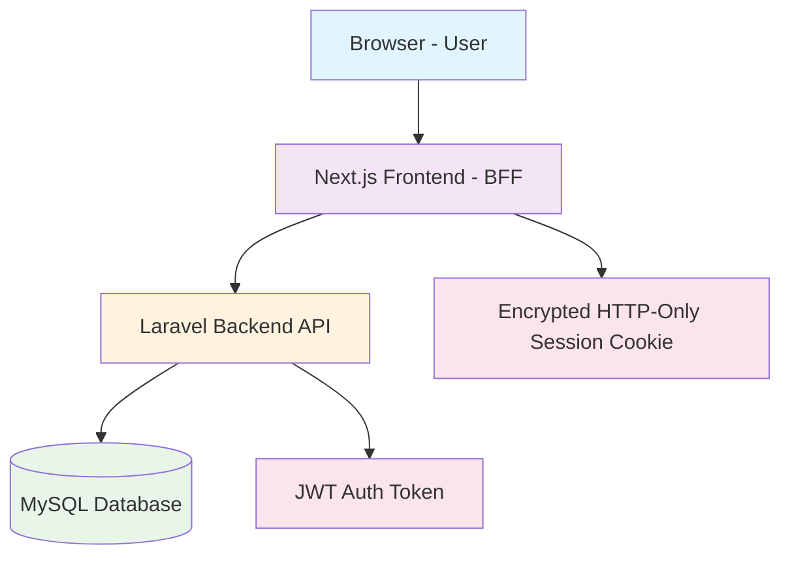
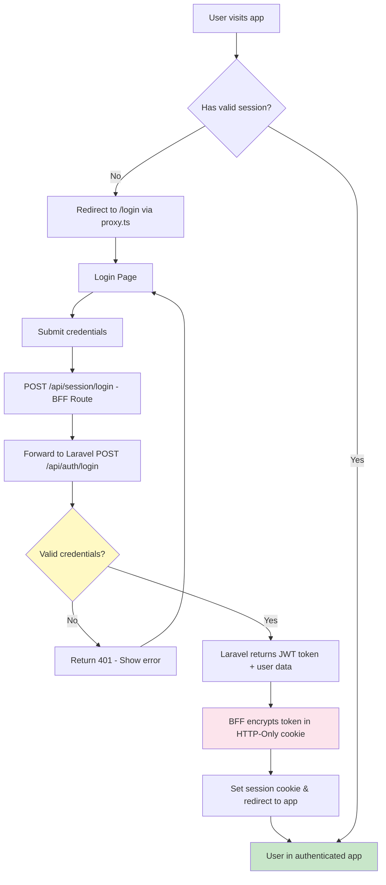
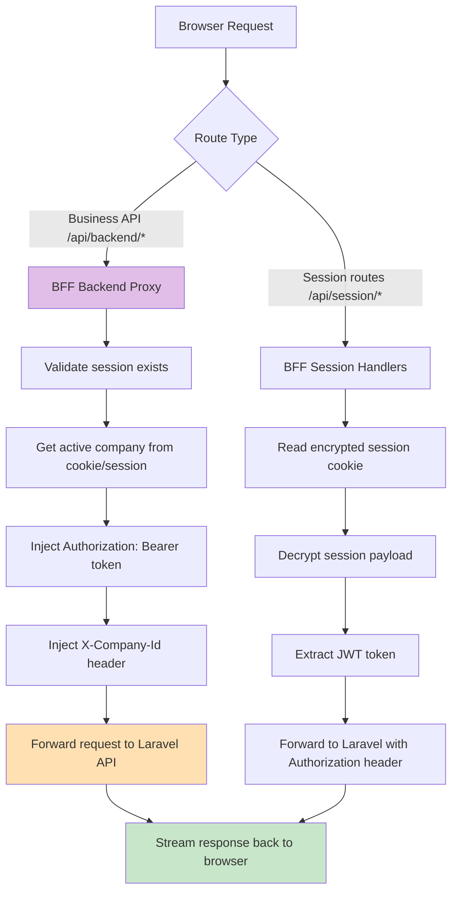
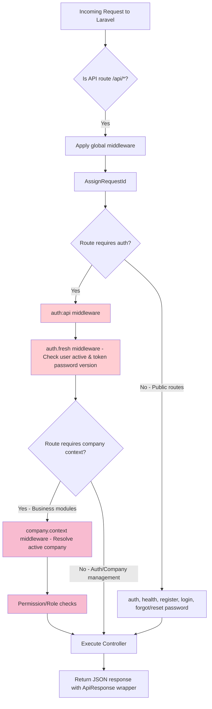
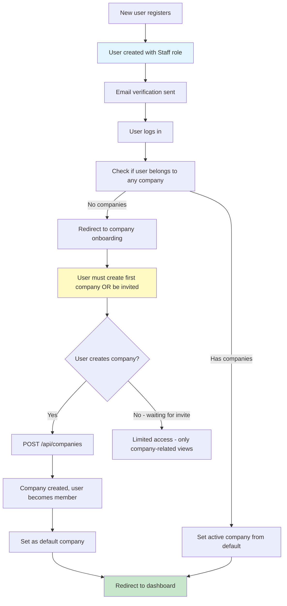
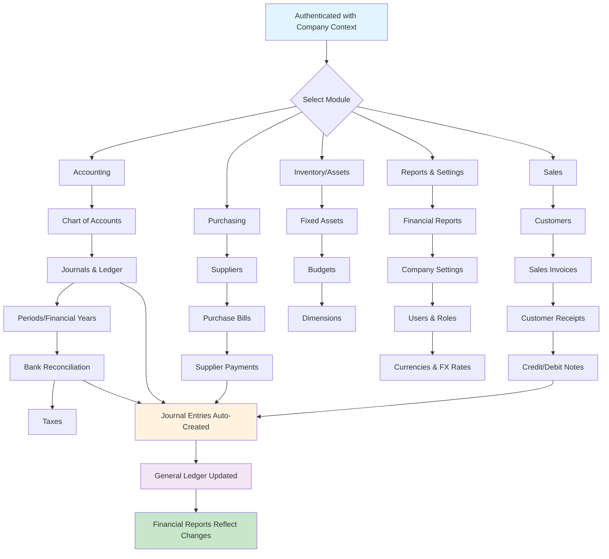

# Accountance Web App - Working Process Flowchart

This document explains the end-to-end working process of the Accountance web application with flowcharts for easy understanding.

## 1. High-Level Architecture



**Flow Explanation:**
1. User interacts through the browser
2. Frontend acts as a Backend-For-Frontend (BFF) using Next.js 16
3. BFF communicates with Laravel 13 REST API
4. Data is persisted in MySQL 8

## 2. Authentication Flow



### Authentication Endpoints

| Flow | BFF Route | Laravel Route | Purpose |
|---|---|---|---|
| Login | `POST /api/session/login` | `POST /api/auth/login` | User authentication with JWT |
| Register | `POST /api/session/register` | `POST /api/auth/register` | New user registration (grants Staff role) |
| Logout | `POST /api/session/logout` | `POST /api/auth/logout` | Invalidate session |
| Get Current User | `GET /api/session/me` | `GET /api/auth/me` | Fetch authenticated user details |
| Forgot Password | `POST /api/session/forgot-password` | `POST /api/auth/forgot-password` | Send password reset email |
| Reset Password | `POST /api/session/reset-password` | `POST /api/auth/reset-password` | Reset password with token |
| Change Password | `PUT /api/session/password` | `PUT /api/auth/password` | Change password while logged in |
| Email Verification | `POST /api/session/verify-email/*` | Various `/api/auth/email/verification-notification` & `/api/auth/email/verify/*` | Email verification flow |

## 3. BFF Proxy Architecture



**Key Security Features:**
- Browser never sees or stores JWT tokens directly
- All tokens are encrypted in HTTP-Only session cookies (AES-256-GCM)
- BFF injects auth headers server-to-server
- Active company context injected via `X-Company-Id`
- Path validation & traversal protection in proxy
- 401 responses clear session and redirect to login

## 4. Route Protection & Middleware



**Middleware Stack:**
- `auth:api` - JWT authentication
- `auth.fresh` - Ensures user is active and token not invalidated by password change
- `company.context` - Validates user belongs to active company and resolves context
- `permission:*` / `role:*` - Spatie Permission checks
- `throttle:*` - Rate limiting (auth, login, register, api, etc.)

## 5. User Onboarding & Company Setup Flow



**Notes:**
- Self-registered users get `Staff` role with minimal permissions (`companies.view` only)
- Staff cannot create companies by default - requires proper permissions
- First company setup is critical for accessing business modules
- Company membership is many-to-many with `is_default` pivot flag

## 6. Core Business Modules Flow



## 7. Document Lifecycle (Sales Invoice Example)

```mermaid
sequenceDiagram
    participant U as User
    participant F as Frontend
    participant B as BFF Proxy
    participant L as Laravel API
    participant DB as Database
    
    U->>F: Create Sales Invoice
    F->>B: POST /api/backend/sales/invoices
    B->>L: Forward with auth + company context
    L->>L: Validate permissions (sales.invoices.create)
    L->>L: Validate customer, items, taxes
    L->>DB: Create invoice (status: draft)
    DB-->>L: Invoice created
    L-->>B: Return invoice data
    B-->>F: Return response
    F-->>U: Show invoice in draft
    
    U->>F: Post Invoice
    F->>B: POST /api/backend/sales/invoices/{id}/post
    B->>L: Forward request
    L->>L: Check permissions (sales.invoices.post)
    L->>L: Validate period open, accounts valid
    L->>DB: Create Journal Entry
    L->>DB: Update invoice status to posted
    L->>DB: Update customer balance
    DB-->>L: All changes committed
    L-->>B: Success response
    B
